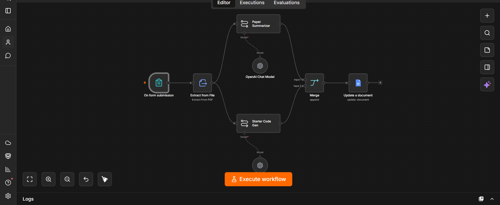
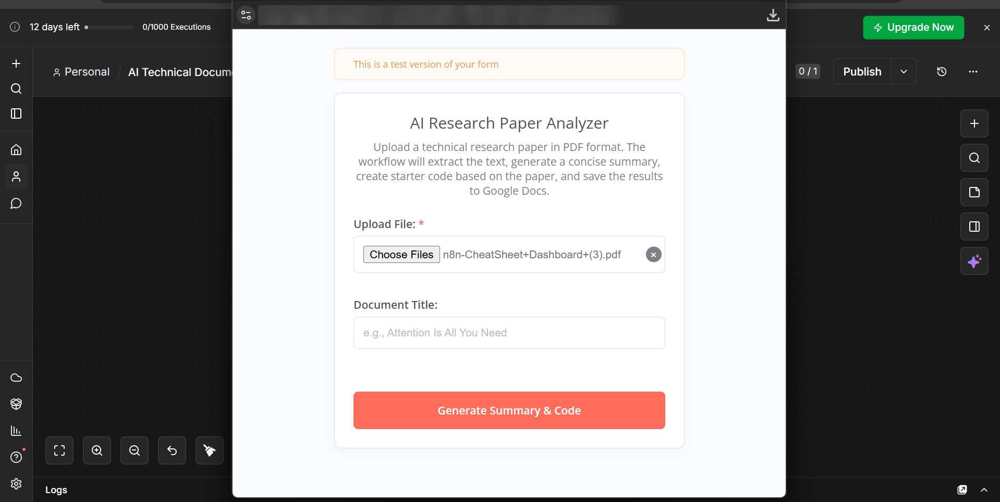
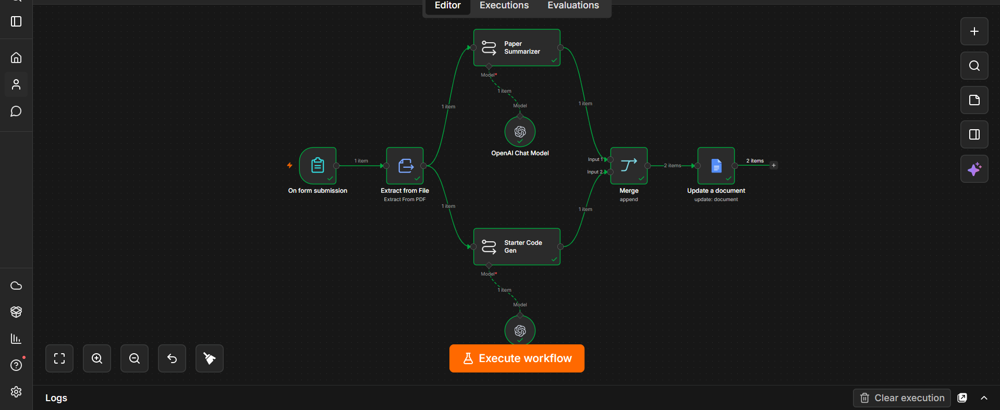
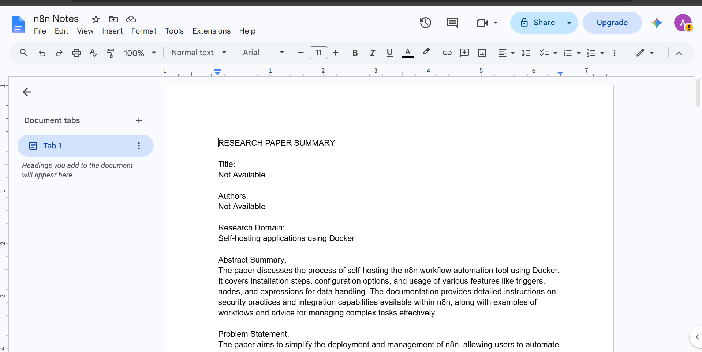
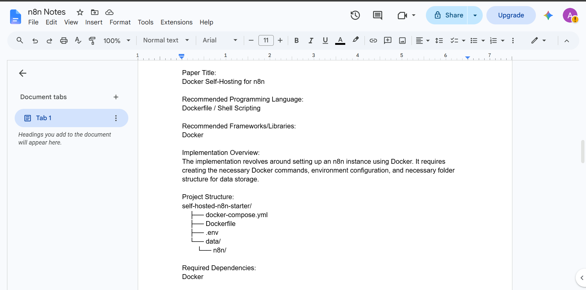

# 🤖 AI Technical Document Analyzer

An **n8n** workflow that analyzes technical PDF documents with AI, produces a structured summary **and** starter code, and saves the combined report directly to Google Docs.



---

## ✨ Features

- 📤 Upload a technical PDF through an n8n Form
- 📑 Automatic text extraction from the PDF
- 📝 AI-generated structured summary (problem, solution, methodology, findings…)
- 💻 AI-generated starter code based on the document
- 🔀 Merges both outputs into a single report
- 📄 Writes the report straight into a Google Doc
- 🧾 Plain-text output optimized for Google Docs (no Markdown/HTML artifacts)

---

## 🔄 How It Works

```text
                                            ┌─► Paper Summarizer (LLM) ──┐
Form Submission ─► Extract from File (PDF) ─┤                            ├─► Merge ─► Google Docs
                                            └─► Starter Code Gen (LLM) ──┘
```

1. **On form submission** – the user uploads a PDF and gives it a title.
2. **Extract from File** – text is extracted from the PDF.
3. **Paper Summarizer** – an LLM chain creates a structured summary.
4. **Starter Code Gen** – a second LLM chain generates implementation starter code.
5. **Merge** – both outputs are combined.
6. **Update a document** – the final report is written to Google Docs.

---

## 📄 Report Contents

- Technical summary
- Problem statement
- Proposed solution
- Methodology
- Key concepts & technologies
- Findings
- Starter code
- Implementation notes
- Suggested next steps

---

## 🛠️ Tech Stack

| Tool | Purpose |
| --- | --- |
| n8n | Workflow automation |
| n8n Forms | PDF upload |
| Extract from File | PDF text extraction |
| OpenAI (`gpt-4o-mini`) | Summary & code generation |
| Google Docs | Report output |

---

## 📥 Setup

1. Download [`workflow.json`](workflow.json).
2. In n8n, go to **Workflows → Import from File** and select it.
3. Add your credentials:
   - **OpenAI API** for both *OpenAI Chat Model* nodes
   - **Google Docs OAuth2** for the *Update a document* node
4. In *Update a document*, set the ID/URL of the Google Doc you want to write to.
5. Activate the workflow and open the form URL.

### Form fields

| Field | Type |
| --- | --- |
| Upload File | File (PDF) |
| Document Title | Text |

---

## 📸 Screenshots

| Submission form | Execution |
| --- | --- |
|  |  |

| Result (part 1) | Result (part 2) |
| --- | --- |
|  |  |

---

## 💡 Use Cases

- 📚 Research paper analysis
- 🔌 API documentation review
- 🏗️ Software architecture analysis
- 📑 Whitepaper summarization
- 👨‍💻 Developer onboarding
- 🚀 AI-assisted code scaffolding

---

## 📜 License

This project is licensed under the [MIT License](LICENSE).
